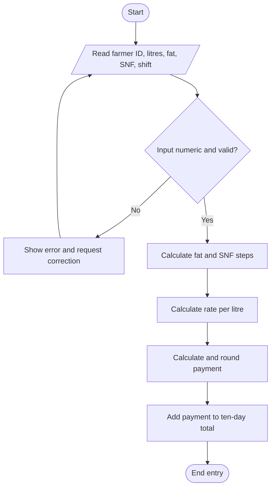

# Task 8 – Algorithm and Hand Trace

| Entry | Litres | Fat | SNF | Fat steps | SNF steps | Rate (Rs/L) | Amount (Rs) |
|---|---:|---:|---:|---:|---:|---:|---:|
| 1 | 10.0 | 3.5 | 8.5 | 0 | 0 | 30.00 | 300.00 |
| 2 | 8.5 | 4.2 | 8.7 | 7 | 2 | 33.40 | 283.90 |
| 3 | 12.0 | 3.1 | 8.3 | -4 | -2 | 27.80 | 333.60 |
| **Total** | | | | | | | **917.50** |

The algorithm is understand → plan → write → test. A running total requires O(n) time and O(1) extra storage. Retaining all entries requires O(n) space and is still necessary when the co-operative needs an audit trail, farmer-wise statements, corrections or later re-calculation.

Flowchart (Mermaid):

